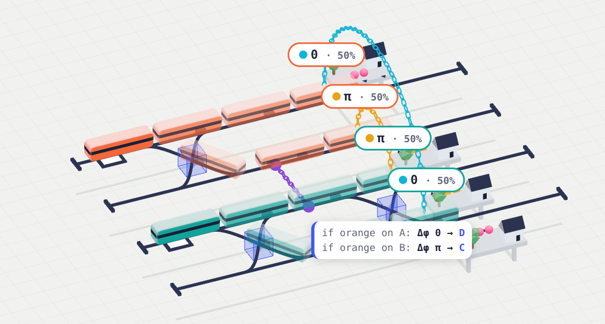
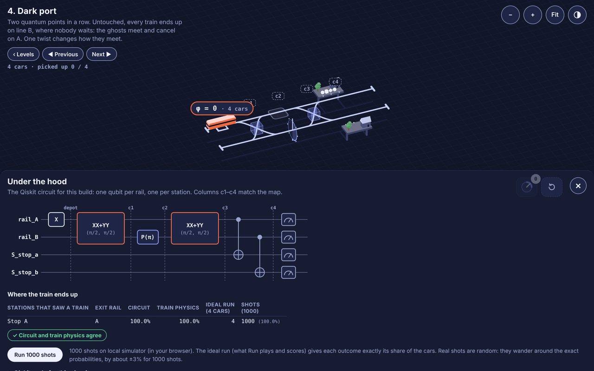
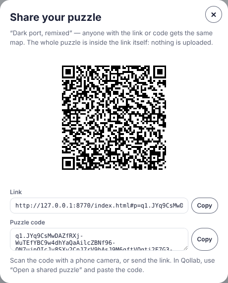

# Quantrain

**A quantum puzzle game on a metro map. Your train is a single photon.** Lay out beam splitters, phase twists,
crossovers and interlocks so that interference delivers every passenger with one press of **Run**. Every map
is a real Qiskit circuit that you can read and run on a simulator or IonQ hardware.

**▶ Play:** https://thohmass.github.io/Quantrain/prototype/ · **On Qollab:** https://qollab.xyz/u/Quantomas/quantrain · **Video:** {{VIDEO_URL}}



## What's inside

* **15 levels** that each teach one idea: superposition, interference, phase, which-path measurement,
  entanglement and correlations.
* **Ghosts you can see:** the train is on several tracks at once, its roll is its phase, and entangled
  branches hang together on a chain.
* **Under the hood:** the Qiskit circuit and code for your build, the exact probabilities from two independent
  calculations, and 1000 real shots on the backend you choose on Qollab.
* **Playground and community puzzles:** build anything, turn it into a puzzle, and share it by link, QR code
  or a short code. Nothing is uploaded: the whole puzzle is in the link.
* **Runs everywhere:** desktop and phone, light and dark mode, touch and mouse.

## Play

| Where | How |
|---|---|
| Any browser | Open the **Play** link, or `prototype/index.html` from this repository. |
| Qollab | Open the project and press **Run**. Pick any backend in *Select QPU*; IonQ works too. Needs a recent Chrome or Edge. |

## The levels

| # | Level | Idea | # | Level | Idea |
|---|---|---|---|---|---|
| 1 | First departure | a car is one shot | 9 | Grand junction | four-way interference |
| 2 | Twist tunnel | phase | 10 | Nosy inspector | which-path information kills interference |
| 3 | Quantum points | superposition, measurement | 11 | Switch both ways | phase 0 or π picks the exit |
| 4 | Dark port | interference (Mach–Zehnder) | 12 | Remote twist | controlled phase between two trains |
| 5 | Quarter turn | only phase differences matter | 13 | Remote switch | entanglement |
| 6 | Switchyard | crossovers | 14 | Entangled couples | perfect correlations |
| 7 | Crossed wires | when a swap changes nothing | 15 | Swap partners | choosing what is correlated |
| 8 | Fair shares | chained splits: ½, ¼, ¼ | | | |

## How it works

| On the map | In the circuit |
|---|---|
| track | one qubit (path encoding: the train's track is `1`) |
| twist | `P(k·π/4)` |
| quantum points | `XXPlusYYGate(θ, π/2)`: a beam splitter |
| crossover | `SWAP` |
| interlock | `CZ` between two trains: entangles them |
| station | `CX` into its own qubit: a which-path detector |

A run sends a train of cars, and each car is one shot. Stars come from the **ideal run**: the cars are spread
over the outcomes exactly by their probabilities, so the score depends on your build, not on luck.
Full explanation: [`docs/HOW_IT_WORKS.md`](docs/HOW_IT_WORKS.md).



## Verified physics

* An independent simulator written without Qiskit matches Qiskit's statevector to within 1e-8. This holds for
  every level solution and for random maps of up to 10 tracks and 4 trains.
* The browser's JavaScript engine and the Python translator build the same circuit, gate for gate. This was
  checked on 262 circuits, including 40 random community puzzles sent through the share code and back.
* Every level is cleared with ★★★ by its intended solution in one run, and the tempting wrong builds score less.

```bash
pip install -r requirements.txt
python tests/test_engine.py        # 15 checks
python tests/test_js_parity.py     # browser engine == Python translator (needs Node.js)
```

## Community puzzles

In the Playground, **✎ Make a puzzle** fixes everything you placed. Then choose:

* the pads the player may build on;
* the blocks they get;
* passengers, couples and cars.

Clear it yourself with ★★★ to unlock **Share**: a link, a QR code and a puzzle code. **Open a shared puzzle** in the
menu takes a link or a code, and **Remix** copies any puzzle into your Playground. Format:
[`docs/LEVEL_FORMAT.md`](docs/LEVEL_FORMAT.md#share-codes-community-puzzles).



## Accessibility

* Every block can be placed without dragging: Tab to a block in the dock and press Enter, and it goes on the
  first free pad. Run, Under the hood, the menus and every dialog work from the keyboard. Escape closes
  dialogs and panels.
* Icon buttons and blocks have text labels for screen readers, and keyboard focus is always visible.
* Under the hood gives a text version of the whole map: the circuit as Qiskit code and a probability table.
* Passengers differ by shape as well as colour. Trains and stations are named.
* Light and dark mode follow the system, with a manual switch. Layouts work on phones (touch, press and hold
  for labels).
* Known gaps: turning a twist or moving a single block needs a pointer. The 3D map itself is not described to
  screen readers. Reduced-motion settings only calm the result card, not the trains.

## For developers

```bash
python -m quantrain levels/04-dark-port.json --solution half-turn   # grid, circuit, probabilities, sampled run
python tools/build_prototype.py                                    # build prototype/index.html from prototype/src + levels
python tools/build_qollab.py                                       # Qollab project: qollab/ + dist/quantrain-qollab.zip
```

| Path | What |
|---|---|
| `quantrain/` | Python engine: `level.py` (load, validate), `circuit.py` (map → Qiskit), `score.py` (ideal run), `reference.py` (physics without Qiskit), `qollab.py` (one-job bridge on Qollab) |
| `levels/` | the 15 levels (`quantrain-level/1`), each with example solutions used by the tests |
| `prototype/` | the browser game: `src/app.html` + `src/engine.mjs` (the same translator in JavaScript), built into `index.html` |
| `tests/`, `tools/` | the checks above; build scripts and the Node exporters the parity test uses |
| `qollab/`, `dist/` | the built Qollab project and its zip (generated) |
| `docs/` | [how it works](docs/HOW_IT_WORKS.md) · [level format and making levels](docs/LEVEL_FORMAT.md) · [Qollab project page](docs/QOLLAB_README.md) · [design notes](docs/design/) |

Share links inside a frame (Qollab) need the game's public address in `prototype/public_url.txt`; rebuild after
changing it.

## Credits and disclosure

* **Built during the hackathon.** All code, levels and documentation were written during the build weekend
  (10–11 Oct 2026) by Bc. Tomáš Roch. No code existed before, and no Qollab template was used.
* **AI assistance.** Development used an AI coding assistant (Claude, by Anthropic) for code, tests and
  documentation, under the author's direction.
* **Open-source software:**
  * [Qiskit](https://github.com/Qiskit/qiskit) (Apache-2.0)
  * [three.js](https://github.com/mrdoob/three.js) with its OrbitControls add-on (MIT): 0.170 from jsDelivr in
    the browser build, 0.186 provided by Qollab.
  * [qrcode-generator](https://github.com/kazuhikoarase/qrcode-generator) 1.4.4 by Kazuhiko Arase (MIT), vendored
    in `prototype/src/vendor/` with its licence header.
  * The fonts [Figtree](https://fonts.google.com/specimen/Figtree) and
    [JetBrains Mono](https://fonts.google.com/specimen/JetBrains+Mono) (SIL Open Font License 1.1).

Built for the Qollab × IonQ quantum hackathon (Oct 2026), theme *Quantum Playground*.
This effort is supported by Qollab & IonQ. License: [MIT](LICENSE).
